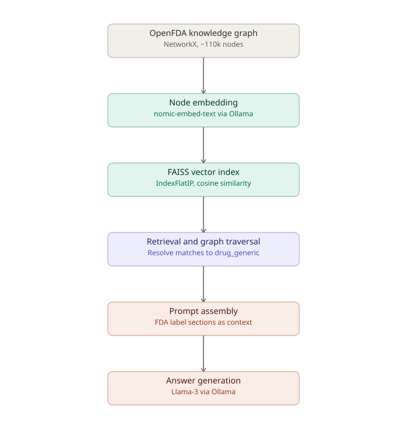
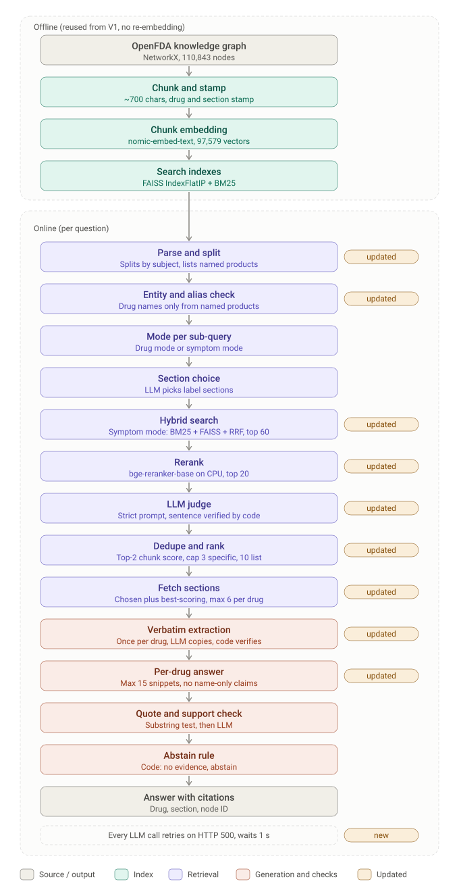
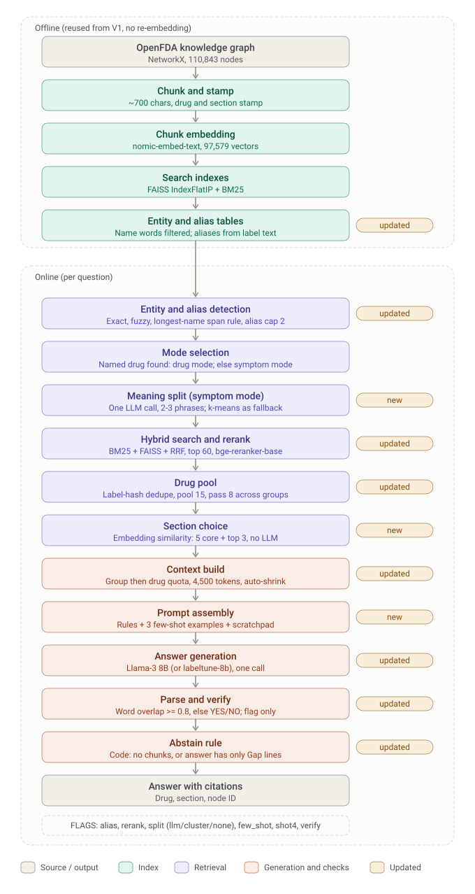

# GraphRAG OpenFDA

A question-answering system over FDA drug labels. It combines a **knowledge graph** (NetworkX), **hybrid search** (FAISS + BM25), and a local **Llama-3 8B** (via Ollama) to give answers that are grounded in label text, cited, and able to say "not enough information".

The repo contains five system versions (V0 to V4), a 60-question evaluation set, scoring results, and a fine-tuning experiment.

**Quick links**

| What | Link |
|---|---|
| Full results (all versions, category-wise and question-wise) | [Results/results.md](https://github.com/75Dineshchandra/GraphRAG_OpenFDA/blob/main/Results/results.md) |
| Step-by-step architecture and code guide (what, why, how for every step) | [code/architecture_and_code.md](https://github.com/75Dineshchandra/GraphRAG_OpenFDA/blob/main/code/architecture_and_code.md) |
| Large data files (graph, embeddings, index) | [Google Drive folder](https://drive.google.com/drive/folders/1C0KmSjRvNmOW-PvxzUiedcediCZHdZAl?usp=sharing) |

---

## 1. Problem and goal

Large language models can make up medical facts. Drug labels are long, repetitive, and full of near-duplicate products, so a plain "embed and search" system often picks the wrong drug or mixes labels.

**Goal:** answer a question using only the retrieved FDA label text, show which label section each claim came from, and refuse when the label does not say.

---

## 2. The data

Source: openFDA drug-label records stored as one NetworkX graph (`OpenFDA_graph.pkl`, on Drive).

| Item | Value |
|---|---|
| Nodes / edges | 110,843 / 355,909 (undirected) |
| `drug_generic` nodes | 10,840 |
| `drug_brand` nodes | 31,797 (each links to a generic via `BRAND_GENERIC`) |
| Section nodes | 14 types, e.g. `indications_and_usage`, `warnings`, `do_not_use`, `pregnancy_or_breast_feeding`, `dosage_and_administration` |
| Where the text is | Drugs/brands: in `name`. Sections: in `description` |

**Important detail:** every generic drug connects directly (1 hop) to all its section nodes. Sections also connect to each other in a dense mesh, but that is a build artifact (a `DOSAGE_WARNING` edge does not mean dosage causes warnings). All versions **ignore the section-to-section edges** and only follow drug → section. See `graph_characteristics.txt` for the full graph statistics.

---

## 3. System versions

| Version | Code | Diagram | Main idea |
|---|---|---|---|
| **V0 baseline** | `code/graphrag_openfda.py` | `architecture.svg` | Embed whole nodes, FAISS search, answer from retrieved drug labels |
| **V1 Adv GraphRAG** | `code/adv_graphrag.py` | `v1_adv_graphrag_architecture.svg` | Chunking, BM25 + FAISS hybrid search, intent routing, citations, abstention |
| **V2 LLM-centric** | `code/v2_adv_rag.py` | `v2_architecture_updated.svg` | LLM parses, judges and extracts; code verifies each step |
| **V3 lean, few-shot** | `code/v3_graphrag.py` | `v3_architecture.svg` | Almost no LLM before the answer; reranker; few-shot prompt; code-based verify and abstain |
| **V4 fine-tuned** | `Finetune_8B/` | none | V3 pipeline with a QLoRA-tuned model (`labeltune-8b`). **Trained, not yet evaluated** |

### V0: baseline


Embeds all ~110k nodes with `nomic-embed-text`, searches with FAISS (`IndexFlatIP`, cosine), maps each hit to its parent generic drug, and sends the label to Llama-3.
**Problems found:**  long sections get one diluted vector; symptom questions drift to unrelated (often homeopathic) labels; no citations or abstention.

### V1: Adv GraphRAG


- Splits each section into ~700-character chunks and stamps each with `[DRUG: ... | SECTION: ...]` (97,579 chunks, re-embedded).
- BM25 (exact words) + FAISS (meaning), merged with Reciprocal Rank Fusion.
- Drug-name detection with a data-driven filter that drops category words like "cold" or "antacid".
- Two modes: **drug mode** (a drug is named) and **symptom mode** (search indications and purpose).
- Token-budgeted context, source tags `[S1]`, a YES/NO support check, and abstention.

### V2: LLM-centric, verified


Rule: *the LLM proposes, the code verifies.* Adds an LLM question parser/splitter (handles comparisons and two-meaning words), alias table for brands found only in label text, cross-encoder reranker (`bge-reranker-base`), LLM relevance judge, verbatim quote extraction, per-drug answers, and a code-decided abstain rule. Slowest version, and the extra steps sometimes dropped good evidence (over-abstention).

### V3: lean Hybrid retrieval, few-shot answer


Rule: *use the LLM only where code cannot do the job.* Data-driven entity and alias detection, a "longest-name span" rule for comparisons, optional meaning split for ambiguous words (k-means fallback), reranking, section choice by embedding similarity (no LLM), larger context (4,500 tokens with auto-shrink), a prompt with 3 worked examples and a scratchpad, `Gap:` lines for missing facts, and a word-overlap check before any LLM verification. Typically one answer call per question.

### V4: fine-tuned model (Failed evaluation)
QLoRA fine-tune of Llama-3 8B on 3,000 reshaped rows of `medical-o1-reasoning-SFT` (no OpenFDA text, to avoid leaking the test material). Packaged as the Ollama model `labeltune-8b`. the finetuned model failed as we trained the model for CoT but the finetuned model could not perform CoT and added noise to every analysis and answer which is expected as model parameters are very few. See section 7.

---

## 4. Evaluation set

`Results/QA.json`: **60 questions** in eight test types, keyed by `qid` (e.g. `qa["T1-001"]`). Schema per question: `qid`, `question`, `answer`, `trace`, `sections`, `answerable`. The model only sees the question; the answer key stays hidden.

| Type | What it tests | Qs |
|---|---|---|
| T1 Drug-specific | Named drug, safety question | 6 |
| T2 Symptom + safety | Symptom only, system must find drugs | 8 |
| T3 Brand | Brand name that maps to a generic | 9 |
| T4 Ambiguous | Word with two meanings ("cold", "burn") | 9 |
| T5 Comparison | Two drugs side by side | 9 |
| T6 Unanswerable | Label does not say; must decline | 9 |
| T7 Long sections | Long dosage text / tables | 5 |
| T8 Citation integrity | Reused T1-T6 questions with an injected false sentence in the key | 5 |

**Scoring labels:** correct, partially correct, wrong. Answers were compared by hand to the answer key and the real label text.

---

## 5. Results

| Version | Correct | Partially correct | Wrong | Strict accuracy | Correct + partial |
|---|---:|---:|---:|---:|---:|
| V0 Base | 14 | 30 | 16 | 23.3% | 73.3% |
| V1 | 24 | 24 | 12 | **40.0%** | 80.0% |
| V2 | 17 | 25 | 18 | 28.3% | 70.0% |
| V3 | 24 | 25 | 11 | **40.0%** | **81.7%** |
| V4 | not yet run | | | | |

By category (correct / partially correct / wrong):

| Test | Base | V1 | V2 | V3 |
|---|---|---|---|---|
| T1 Drug-specific (6) | 0/3/3 | 3/2/1 | 0/6/0 | 3/2/1 |
| T2 Symptom (8) | 2/4/2 | 1/4/3 | 0/4/4 | 2/4/2 |
| T3 Brand (9) | 6/2/1 | 4/1/4 | 2/3/4 | 3/2/4 |
| T4 Ambiguous (9) | 0/8/1 | 0/9/0 | 4/4/1 | 1/7/1 |
| T5 Comparison (9) | 0/5/4 | 2/5/2 | 0/5/4 | 1/7/1 |
| T6 Unanswerable (9) | 5/3/1 | 8/0/1 | 8/0/1 | 9/0/0 |
| T7 Long sections (5) | 0/1/4 | 4/0/1 | 3/0/2 | 3/1/1 |
| T8 Citation (5) | 1/4/0 | 2/3/0 | 0/3/2 | 2/2/1 |

**Key findings**

- **Retrieval failure in early and few T cases**, not generation: wrong drug, only one of two drugs, or near-duplicate labels splitting the context.
- **Chunking + hybrid search (V0 → V1)** gave the biggest jump: 23.3% → 40.0% strict accuracy, and fixed long-section questions (T7).
- **More LLM steps did not help (V2).** Each extra step could drop good evidence, causing over-abstention and incomplete answers. It was best only on ambiguity (T4).
- **V3 matches V1 on strict accuracy with the fewest wrong answers (11)**, perfect abstention on unanswerable questions (9/9), and no injected sentence repeated in citation tests, with far fewer LLM calls than V2.
- **Still unsolved in V3:** brands whose name appears only inside label text (A and D, Forticept, DermaWound), symptom drift (T2-001/002), ambiguity handling, two junk outputs (T3-009, T5-008), and answers missing the pregnancy line or the second drug.


---

## 6. Technical summary of the pipeline (V3)

1. **Offline (reused from V1, no re-embedding):** graph → ~700-char stamped chunks → `nomic-embed-text` vectors → FAISS + BM25, plus entity and alias tables.
2. **Entity and alias detection** on the question (exact, fuzzy fallback, span rule, alias cap 2).
3. **Mode selection:** named drug → drug mode; otherwise symptom mode.
4. **Meaning split** (symptom mode): one LLM call for 2-3 search phrases, k-means as fallback.
5. **Hybrid search + rerank:** BM25 + FAISS + RRF, top 60, `bge-reranker-base`.
6. **Drug pool:** dedupe identical labels (md5 hash), pool 15, pass 8.
7. **Section choice:** 5 core sections + 3 closest by embedding similarity.
8. **Context build:** 4,500-token budget split by group then drug, `NOTE: no text for ...` lines, auto-shrink to fit the 8,192 context.
9. **Prompt:** rules + 3 few-shot examples + scratchpad.
10. **Answer:** Llama-3 8B, temperature 0.1.
11. **Verify:** ≥80% word overlap with the cited text, else YES/NO check; claims are flagged, not deleted.
12. **Abstain (decided by code):** no chunks retrieved, or only `Gap:` lines.
13. **Output:** bullets with `[S#]` tags mapped to drug, section and node ID.

Settings are in the `FLAGS` dict at the top of `v3_graphrag.py` (`alias`, `rerank`, `split`, `few_shot`, `shot4`, `verify`), so each component can be switched off for ablation. The full step table is in [code/architecture_and_code.md](https://github.com/75Dineshchandra/GraphRAG_OpenFDA/blob/main/code/architecture_and_code.md).

---

## 7. Fine-tuning experiment (V4, `Finetune_8B/`)

| Item | Setting |
|---|---|
| Base model | `NousResearch/Meta-Llama-3-8B-Instruct` (ungated copy of the model Ollama serves as `llama3:8b`) |
| Method | QLoRA: 4-bit NF4, LoRA r=16, alpha=32, dropout 0.05, all attention and MLP layers (41.9M trainable parameters, 0.52%) |
| Data | 3,000 rows of `FreedomIntelligence/medical-o1-reasoning-SFT` (English), reshaped into the pipeline format: excerpt `[S1]`, a short `Reasoning:`, then one cited bullet. **No OpenFDA text** (leakage rule) and no synthetic data |
| Training | batch 2 × accumulation 8, 2 epochs (376 steps), lr 2e-4 cosine, loss on answer tokens only; loss fell from ~1.12 to ~0.62 |
| Packaging | merge in bf16 → GGUF f16 → `q4_k_m` → Modelfile → `ollama create labeltune-8b` |
| Smoke test | 2 of 3 held-out questions followed the trained format; the third was cut by the 300-token cap |

The first merge failed because the adapter was merged into a 4-bit model (GGUF conversion refuses bitsandbytes); merging into a bf16 copy fixed it.

but the finetuned model could not perform CoT and added noise to every analysis and answer which is expected as model parameters are very few.

---

## 8. Repository layout

```
GraphRAG_OpenFDA/
├── README.md
├── requirements.txt
├── graph_characteristics.txt        # graph statistics
├── architecture.svg                 # V0 diagram
├── v1_adv_graphrag_architecture.svg
├── v2_architecture_updated.svg
├── v3_architecture.svg
├── code/
│   ├── graphrag_openfda.py          # V0
│   ├── adv_graphrag.py              # V1
│   ├── v2_adv_rag.py                # V2
│   ├── v3_graphrag.py               # V3
│   └── architecture_and_code.md     # detailed guide
├── Finetune_8B/
│   ├── graphrag_finetune_llama3_8b.py
│   └── LabelTune_FineTune_README.md
└── Results/
    ├── results.md                   # combined comparison
    ├── QA.json                      # 60-question set
    ├── scoring_base_results.json    # V0 scoring notes
    ├── score_adv_Rag.md             # V1 scoring
    ├── V2_score_adv_Rag.md          # V2 scoring
    ├── V3_score.txt                 # V3 scoring
    └── training_summary.json        # fine-tune record
```

---

## 9. Data files (Google Drive)

The graph and embedding files are too large for GitHub:
**https://drive.google.com/drive/folders/1C0KmSjRvNmOW-PvxzUiedcediCZHdZAl?usp=sharing**

- `OpenFDA_graph.pkl`: the knowledge graph (needed by V1-V3).
- V0 files: `graph_with_embeddings.pkl`, `graph_nodes.index`, `node_id_map.pkl` (`embeddings_checkpoint.pkl` only for resuming).
- V1 output (needed by V2 and V3): `Adv_graphRAG/chunks_<SIG>.pkl`, `shards_<SIG>/`, `faiss_<SIG>.index`.
- `QA.json`: evaluation questions.

Expected Colab layout: `MyDrive/Research_kgTxagent/graph_rag/` (set `BASE_DIR` at the top of each script).

---

## 10. Setup and running

**Requirements:** Python 3.9+, [Ollama](https://ollama.com/download), a GPU runtime (T4) for V1 embedding and fine-tuning.

```bash
python -m pip install -r requirements.txt
ollama serve
ollama pull llama3:8b
ollama pull nomic-embed-text
```

On Colab, each script installs and starts Ollama itself. Colab storage resets, so this repeats every session; Drive keeps the data.

| Step | What to do |
|---|---|
| V0 | Run `graphrag_openfda.py` cells in order (full embedding takes ~1 h 47 min) |
| V1 | Run `adv_graphrag.py` on a GPU; creates chunks, embeddings and FAISS index in `Adv_graphRAG/` |
| V2 / V3 | Run `v2_adv_rag.py` or `v3_graphrag.py`; both reuse the V1 index. Set `RESET=False` to resume after a restart |
| V4 | Train in `graphrag_finetune_llama3_8b.py`, run `ollama create labeltune-8b -f Modelfile` locally, set `LLM_MODEL = "labeltune-8b"` in `v3_graphrag.py`, re-run the audit |
| Score | Compare `final_answer` with `answer_key` in the results JSON using only: correct, partially correct, wrong |

Example question: `What should I avoid if I am pregnant and using lidocaine?`

---

## 11. Known issues to fix next

- **LM Finetuning** Find possible improvements since the CoT is not good enouugh possibly because of parameters

- **Categorical Improvements** the Arch is performing in all aspects better in few T characteristics and not as much in few. hence imporve them. through segmented architecture improvements.

---

## 12. Disclaimer

Research prototype. It is **not** medical advice. Answers only reflect the retrieved FDA label text and can be incomplete or wrong; always check the official label and ask a doctor or pharmacist.
