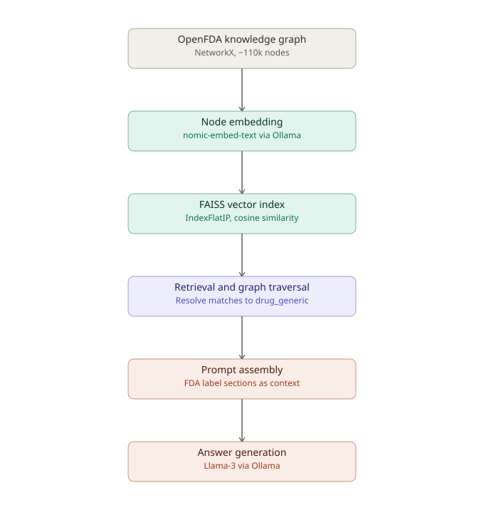
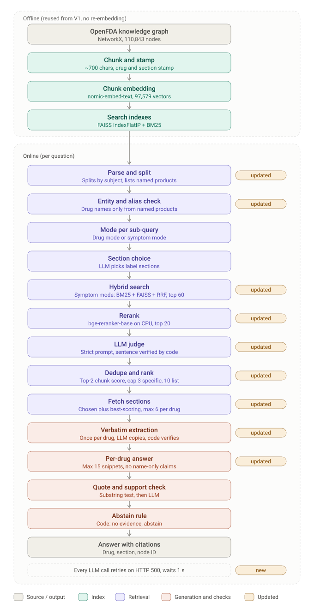
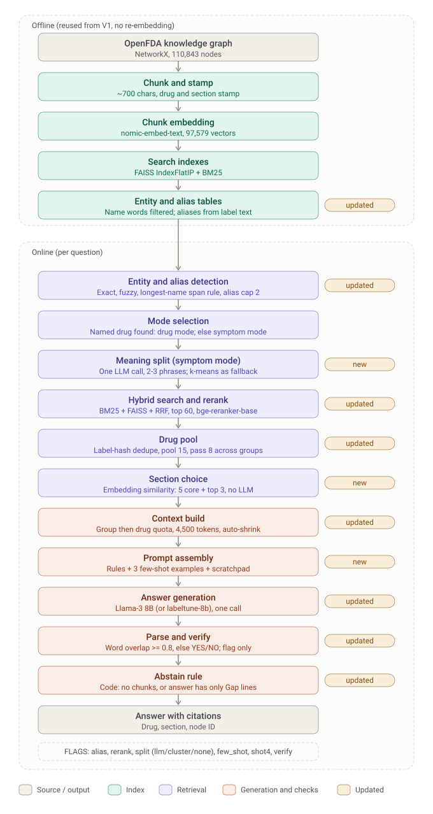

# OpenFDA GraphRAG: Architecture and Code Guide

This document explains the versions of the system we built over the OpenFDA drug-label knowledge graph. For every step it says **what** we did, **why** we did it, and **how** the code does it.

| Version | Code file | Diagram | One-line summary |
|---|---|---|---|
| **V0 (baseline)** | `graphrag_openfda.py` | `architecture.svg` | Embed whole nodes, vector search, answer from one or a few drug labels |
| **V1 (Adv GraphRAG)** | `adv_graphrag.py` | `v1_adv_graphrag_architecture.svg` | Chunking, hybrid search (BM25 + FAISS), intent routing, citations, abstention |
| **V2 (LLM-centric)** | `v2_adv_rag.py` | `v2_architecture_updated.svg` | LLM parses the question, reranks, judges, extracts quotes; code verifies everything |
| **V3 (lean, few-shot)** | `v3_graphrag.py` | `v3_architecture.svg` | Almost no LLM before the answer: data-driven entities, rerank, embedding section choice, few-shot scratchpad answer, code verify and abstain |
| **V4 (fine-tuned, planned)** | `Finetune_8B/graphrag_finetune_llama3_8b.py` | none | Same pipeline as V3 with `LLM_MODEL = "labeltune-8b"` (QLoRA on medical-o1). Not yet evaluated |

Files are saved next to this document so the images below display.

---

## 0. Glossary (plain terms)

| Term | Meaning |
|---|---|
| **Knowledge graph** | Data stored as nodes (things) and edges (links). Here: drugs and label sections. |
| **Embedding** | Text turned into a list of numbers so similar meanings get similar numbers (`nomic-embed-text`). |
| **FAISS** | Library that finds the closest vectors fast. We use `IndexFlatIP` (exact search, inner product). |
| **Cosine similarity** | Score for how alike two embeddings are (higher = more similar). |
| **BM25** | Classic keyword search. Great for rare names and exact words. |
| **RRF (Reciprocal Rank Fusion)** | Merges several ranked lists using rank positions: `score = 1 / (60 + rank)`. |
| **Chunking** | Cutting long text into small pieces (about 700 characters). |
| **Stamping** | Prefixing each chunk with `[DRUG: name \| SECTION: type]` so it carries its drug name. |
| **Reranker (cross-encoder)** | A model that reads the question and a passage *together* and scores relevance. More accurate than embeddings, but slower. |
| **Graph traversal** | Following links. Here: brand → generic drug → its section nodes. |
| **Abstention** | Answering "not enough information" instead of guessing. |
| **Gap line** | V3 output bullet that starts with `Gap:` and says what the label text does not cover. |
| **Support check** | A second check asking whether the cited text really backs a claim. |
| **Few-shot examples** | Worked examples placed in the prompt to show the model the answer format. |
| **Scratchpad** | A short "think first" section the model writes before the answer; stripped before output. |
| **QLoRA** | Fine-tuning small adapter weights on top of a 4-bit quantised base model. |
| **Ablation** | Turning one component off to measure what it contributes. |

---

## 1. The data and the graph (same for all versions)

- **Source:** openFDA drug-label records, stored as a NetworkX graph (`OpenFDA_graph.pkl`), **110,843 nodes, 355,909 edges**, undirected.
- **Node types:**
  - `drug_generic` (10,840) and `drug_brand` (31,797). The node `name` is the text.
  - **Section nodes (14 types)**, for example `indications_and_usage`, `warnings`, `do_not_use`, `dosage_and_administration`, `pregnancy_or_breast_feeding`. The label text is in the `description` field.
- **Edges that matter:**
  - `drug_generic` ↔ each of its section nodes (one hop).
  - `drug_brand` ↔ its one generic parent (`BRAND_GENERIC`).
- **Edges we ignore:** section ↔ section. Every drug's sections are linked to each other in a dense mesh. This is an artifact of how the graph was built (for example a `DOSAGE_WARNING` edge does not mean dosage causes warnings). So V1, V2 and V3 **only follow drug → section edges**.

---

## 2. V0: Baseline GraphRAG (`graphrag_openfda.py`)



### Steps

| # | Step | What | Why | How (code) |
|---|---|---|---|---|
| 1 | Load graph | Load the NetworkX graph | Everything starts here | `pickle.load` of `OpenFDA_graph.pkl`; print nodes/edges |
| 2 | Understand schema | Inspect node/edge types, degrees, sample neighborhoods | Needed to know that drugs connect directly to sections and that the section mesh exists | Counters over node `type`, edge `relation`; print 1-hop neighbours of one drug |
| 3 | Node embedding | Embed **every node** (110,843) with `nomic-embed-text` | So nodes can be searched by meaning | `node_to_text()` builds `"[type] text"` (name for drugs/brands, `description` for sections); `get_embedding()` calls Ollama `/api/embeddings`; 8 threads; checkpoint every 2,000 nodes |
| 4 | Vector index | Build FAISS index | Fast nearest-neighbour search | `faiss.normalize_L2` then `IndexFlatIP`, so inner product = cosine. Saved as `graph_nodes.index` + `node_id_map.pkl` |
| 5 | Retrieval + traversal | Embed the question, search FAISS, resolve each hit to its parent `drug_generic` | Hits can be sections or brands, but the answer needs the whole drug label | `search_graph()` → `get_drug_context()`: if node is not a generic, look for a neighbour whose type is `drug_generic` |
| 6 | Prompt assembly | Put the drug's label sections into a prompt | The LLM must answer from label text only | `build_prompt()` lists sections in a fixed order, caps brand names at 15 |
| 7 | Answer generation | Llama-3 (via Ollama) answers | Produce a readable answer | `ask_llama()`, temperature 0.1, `num_ctx` 8192 |

### The two retrieval modes in V0
1. **Single-drug (first version):** `find_drug_entity()` takes the top FAISS hit that is a drug/brand, `answer_question()` uses only that drug.
2. **Multi-node (enhancement):** `find_drug_entity(query, k=20, threshold=0.70)` keeps all hits above 0.70, `get_drug_context()` resolves each to its generic, removes duplicates, sorts by score, and `build_prompt()` combines all drugs.

### Known problems of V0 (these motivated V1)
- **883 nodes failed to embed** (HTTP 500), almost all long dosage and warning sections. No retrieval was possible for them.
- **Long sections are embedded as one vector**, so detail is diluted or truncated.
- **Symptom questions drift.** "What can I take for headaches while pregnant?" returned warning sections of homeopathic products (about 0.72 cosine), not analgesics.
- **No citations, no abstention, no measurement.**
- **Baseline score on our 60 questions** (`base_results`): 14 correct, 30 partially correct, 16 wrong. Failures were mostly retrieval (wrong drug, or only one of two drugs).

---

## 3. V1: Adv GraphRAG (`adv_graphrag.py`)



The diagram has an **offline** half (built once) and an **online** half (runs per question).

### 3.1 Offline path

| # | Step | What | Why | How (code) |
|---|---|---|---|---|
| 1 | Setup | Mount Drive, install Ollama, pull `llama3:8b` and `nomic-embed-text` | Colab resets, so this repeats each session | Steps 1-4 of the notebook; guards refuse to run if Drive is not mounted |
| 2 | Build lookups | Name tables and drug→section map | Fast traversal without touching the section mesh | Loop over generics; for each neighbour: brand → `BRAND_TO_GENERIC`, section → `DRUG_SECTIONS` |
| 3 | **Chunk and stamp** | Split each section into ~700-char chunks (`MAX_CHARS=700`), 1 unit overlap, prefix with `[DRUG: … \| SECTION: …]` | Fixes long-section failures and gives precise matches. Stamp makes drug name searchable and tells the embedder which drug the text belongs to | `section_text()` strips HTML; `split_units()` splits on ` ; `, bullets, sentence ends; `window_units()` groups units under the size cap. `inactive_ingredient` is excluded (noisy). Chunks saved as `chunks_<SIG>.pkl` |
| 4 | **Chunk embedding** | Embed all chunks, **97,579 vectors** | Re-embedding with chunking removes the 883-node coverage gap | Batches of 64, 4 worker threads, 4,000-chunk shards saved as `.npy` (resumable). `search_document:` prefix. If a batch fails, retry one by one with text cut to 1500/800/400 chars |
| 5 | **Search indexes** | FAISS `IndexFlatIP` + BM25 | Vectors catch meaning, BM25 catches exact rare words (brand names, strengths) | `faiss.normalize_L2`; `bm25s` over the *stamped* text with a custom tokenizer (splits `20mg` → `20 mg`) |

`SIG` is a hash of the chunk settings, so changing chunk settings forces a re-embed and old shards are never mixed in.

### 3.2 Online path

| # | Step | What | Why | How (code) |
|---|---|---|---|---|
| 6 | **Entity and intent detection** | Find drug names in the question; guess which sections are needed | Drug-specific questions should search that drug directly; intent tells which sections to fetch | `detect_entities()` matches name tokens against an entity table. `detect_intent()` uses regex rules (pregnancy, children, dose, stop use, do not use, ask doctor, warnings, storage, uses) mapped to section lists |
| 6a | Name filter (data-driven) | Drop category words like "cold", "antacid" | Otherwise they match as if they were drug names | For each name word: precision = (drugs with word in **name** ∩ drugs with word in **text**) / (drugs with word in text). Entities whose best word is below `PRECISION_MIN=0.15` are dropped |
| 7 | **Mode selection** | **Drug mode** if any entity found, else **symptom mode** | Two question styles need two search strategies | `retrieve()` decides on the whole question |
| 8 | **Hybrid search** | BM25 + FAISS, merged with RRF | Neither alone is reliable on label text | `hybrid_rank()`; `dense_topk()`, `bm25_topk()`, `rrf()` with `RRF_K=60`. Filtered searches score the allowed subset exactly |
| 8a | Symptom mode | Search only `indications_and_usage` + `purpose` (top 60) plus an all-section "safety net" (top 60, weight 0.5) | Symptoms live in indication text; the safety net catches unknown brand names | Drugs scored by the sum of their top 3 chunk scores |
| 9 | **Drug ranking** | Keep top 5 drugs (`MAX_DRUGS`) | Limits prompt size | Sort aggregated scores |
| 10 | **Graph traversal + token budget** | For each drug fetch only the wanted sections within **3,000 tokens (12,000 chars)** split across drugs | Prevents silent truncation; keeps relevant sections | `select_chunks()`: pass 1 picks the best chunk of every wanted section, pass 2 fills the rest by relevance, then sorts in label order. Missing sections are noted (`missing_sections`) |
| 11 | **Prompt assembly** | Tag each chunk `[S1]`, `[S2]` … grouped by drug; rules: only excerpts, bullet per claim, cite tags, abstain sentence if no answer | Makes every claim traceable | `build_prompt()` |
| 12 | **Answer generation** | Llama-3 8B, one call, temperature 0.1 | Produce the cited answer | `llm()` |
| 13 | **Support check and abstain** | Parse bullets into claims; for each cited claim ask the LLM "YES/NO: does this text support the claim?"; flag failures. Abstain before the LLM if no chunks, or in symptom mode if best cosine < `ABSTAIN_COS=0.40` | Catches hallucinated claims and avoids answering from weak evidence | `parse_claims()`, `support_check()`, `answer_question()`. Statuses: `supported`, `unsupported`, `no_citation`, `invalid_citation` |
| 14 | **Output** | Answer with citations: drug, section, node ID | Auditable answers | Each source carries `tag`, `drug`, `section`, `node` (chunk id), `cos` |

### 3.3 Evaluation harness (Step 14-15 of the notebook)
- Loads `QA.json`, runs each question, saves `qa_results_adv.json` after every question (resumable).
- Per question: `drug_recall` (is the gold drug in the retrieved drugs, by name), `section_recall`, `abstain_correct`, `unsupported_rate`, `seconds`.
- Summary table by test type (T1-T8).
- `USE_HYDE` (query expansion) exists but is **off**.

### 3.4 V1 results and diagnosed problems
From `adv_score`: **24 correct, 24 partially correct, 12 wrong** (strict accuracy 40%; correct + partial 80%).

| Problem | Where it hurt | Cause |
|---|---|---|
| Category words matched as drug names | T2-003, T2-006, T2-008, T4-001, T4-007, T4-009, T5-006 | Entity detection ran on the whole question |
| Brand not found | T3-003 (Forticept), T3-004 (DermaWound), T3-006 (Kank-a) | Brands whose name is only in label text, not in the graph |
| Near-duplicate labels split the budget | T1-001, T1-002, T5-003, T7-002 | Several generics with the same name share 12,000 chars |
| Subset rule dropped the plain label | T5-004 | "Acetaminophen 500 mg" is contained in "…with caffeine" |
| Symptom drift | T2-001, T2-002, T2-007 | Search returned unrelated drugs or ingredients |
| Support check passed a garbled claim | T1-004, T5-002 | YES/NO check by a small model is lenient |
| No ambiguity handling | all of T4 | Nothing detects words with two meanings |

---

## 4. V2: LLM-centric, verified (`v2_adv_rag.py`)



**Design rule: the LLM proposes, the code verifies.** Wherever the LLM returns text, code checks that it really appears in the label. V2 reuses V1's saved chunks, shards and FAISS index (no re-embedding). Steps marked **updated/new** in the diagram are changes from V1.

### 4.1 Offline (reused)
Graph, chunks (`chunks_<SIG>.pkl`), shards (`emb_*.npy`), FAISS index and BM25 are loaded from `Adv_graphRAG/`. BM25 is rebuilt in about 15 s.

### 4.2 Online path

| # | Step | What | Why | How (code) |
|---|---|---|---|---|
| 1 | **Parse and split** *(updated)* | LLM returns JSON: `named` (product names literally written), `sub_queries`, `scope` (`specific` or `list`) | Fixes comparison questions (split by drug) and ambiguous words (split by meaning), and stops "cold" or "antacid" being treated as drug names | `parse_question()`, JSON mode. Rules: split by subject, never by aspect; max 3 sub-queries. Falls back to the original question on failure |
| 2 | **Entity and alias check** *(updated)* | Drug names are matched **only inside the products the user named**. Plus an **alias table** for brand words found only in label text | Fixes V1's false positives and missing brands (Kank-a, DermaWound, Forticept) | `named_in()` (exact or fuzzy ≥90 via `rapidfuzz`), `detect_entities()`. Alias table built by scanning all chunks for domain names (≤5 drugs), ™/® words, and rare capitalised words (≤3 drugs, ≥5 letters, not a name word, ≤6 chunks) → `alias_hits()` |
| 3 | **Mode per sub-query** | **Drug mode** if entities/aliases found, else **symptom mode** | Same two-path idea as V1, now per sub-question | `find_drugs()` |
| 4 | **Section choice** | LLM picks 1-5 section names from the 14 types | Replaces V1's fixed regex rules, which missed phrasing | `choose_sections()` returns only valid names |
| 5 | **Hybrid search** *(updated, symptom mode)* | BM25 + FAISS + RRF, top 60 over indications/purpose, plus top 15 all-section safety net | Wider candidate pool for the reranker | `symptom_candidates()` |
| 6 | **Rerank** *(new)* | `bge-reranker-base` cross-encoder scores (question, chunk) pairs, keep top 20 | Embeddings are approximate; a cross-encoder reads both together and is more precise | `get_reranker()` (CPU), `CrossEncoder.predict` |
| 7 | **LLM judge** *(new)* | For each of the 20 chunks: "is this relevant? copy the one most useful sentence exactly" | Removes chunks that are only similar, not answering | `JUDGE_PROMPT`; code checks the copied sentence is really in the chunk with `contains()`. If all rejected, fall back to top 3 reranked (`JUDGE_FALLBACK`) |
| 8 | **Dedupe and rank** *(updated)* | Rank drugs by their top-2 chunk scores; remove drugs with identical label text; cap 3 (specific) or 10 (list) | Stops near-duplicate labels flooding the prompt (a V1 problem) | `label_hash()` (md5 of normalised sections), `dedupe_cap()` |
| 9 | **Fetch sections** *(updated)* | Chosen sections first, then best-scoring others, max 6 per drug, 3,500 chars each | Brings the whole relevant label, not only the searched chunk | `pick_sections()` |
| 10 | **Verbatim extraction** *(new)* | Once per drug and section, LLM copies the sentences that help; code keeps only exact copies | Evidence becomes short, exact, and checkable | `EXTRACT_PROMPT`, `extract_for_drug()` creates tagged sources (`S1…`) |
| 11 | **Per-drug answer** *(updated)* | LLM writes claims as JSON `{claim, sources, quote}` from up to 15 snippets of **one drug at a time** | Keeps drugs separate in comparisons; prevents mixing facts | `generate_claims()`; drops claims under 5 words (name-only) and over-cited claims |
| 12 | **Quote and support check** | 1) the quoted words must be a substring of the cited source; 2) then LLM YES/NO | A substring test is exact; the LLM only judges meaning after that | `check_claims()`. Statuses: `supported`, `unsupported`, `no_citation`, `invalid_citation`, `quote_not_in_source` |
| 13 | **Abstain rule** | **Code decides**: abstain if no drugs found, no verified evidence, or no supported claims | V1 depended on the LLM writing the abstain sentence, which was unreliable (it appeared next to real answers) | `reason` variable in `answer_question()` |
| 14 | **Answer with citations** | Supported claims as bullets with tags; others marked `[FLAGGED: status]` | Auditable output | Records also store `judge` log, `claims`, `unsupported_rate`, `seconds` |
| 15 | **Robustness** *(new)* | Every LLM call retries on HTTP 500 (waits 10 s, 20 s, …) and sleeps 1 s | Long runs on Colab must not die | `llm()` loop; per-question `try/except` |

### 4.3 Settings and ablation flags
```
SEARCH_K=60, RERANK_KEEP=20, SPECIFIC_CAP=3, LIST_CAP=10
EXTRACT_SECTIONS=6, SECTION_CHARS=3500, JUDGE_FALLBACK=3
RRF_K=60, PRECISION_MIN=0.15, EXCLUDE_SECTIONS={inactive_ingredient}
FLAGS = parse, alias, llm_sections, rerank, judge, extract, per_drug, quote_check
```
Setting a flag to `False` turns that step off, so each step's effect can be measured in the ablation table.

### 4.4 Evaluation in V2
- Runs `QA.json`, saves `qa_results_v2.json` after each question (`RESET=True` backs up the old file).
- Adds `drug_recall_ing` (same-ingredient match), because names like "ACETAMINOPHEN 325 MG" vs "ACETAMINOPHEN 325MG" differ only in spelling.
- **T8 citation-integrity test (Step 14):** takes T3-005, injects a made-up claim ("safe for children over 6 years") with a fake quote, runs `check_claims`, prints PASS if the fake claim is not `supported`.

### 4.5 V2 results (from `V2_score_adv_Rag.md`)
**17 correct, 25 partially correct, 18 wrong** (28.3% strict).
- Improved: **T4 ambiguous** (0 → 4 correct), where splitting by meaning helped.
- Not improved or worse: T1 (0 correct, all partial: answers were incomplete), T3-006 and T3-007 (it abstained though the answer was in context), T5-001 (abstained though both drugs were retrieved), T8-002 (Xiclofen not found).
- **Caution when comparing versions:** the score files were graded in different sessions with different strictness (for example V1 T1 shows 3 correct, V2 T1 shows 0 correct). See `results.md` section 5.

---

## 5. V3: lean retrieval, few-shot answer (`v3_graphrag.py`)



**Design rule: spend the LLM only where code cannot do the job.** V2 made many LLM calls before the answer (parse, sections, judge, extraction) and every one of them could drop good evidence (over-abstention, incomplete T1 answers). V3 removes the judge, extraction and per-claim JSON steps, replaces the LLM section choice with an embedding lookup, and puts the effort into (a) better entity detection, (b) a cleaner context, and (c) a prompt with worked examples. It reuses V1's chunks, shards and FAISS index (**no re-embedding**).

LLM calls per question: **one answer call** (always), **one optional meaning-split call** (symptom mode only, flag `split="llm"`), and **verify calls only for claims that fail the code check** (flag `verify`).

### 5.1 Offline (reused plus lookup tables built at load)
Graph, chunks, shards, FAISS and BM25 are loaded exactly as in V2. At load, V3 also builds three lookup tables in memory (about a minute, no LLM):
- **Entity table** (`ENT`): every generic and brand name as a set of word tokens, after dropping entities whose best word has precision below `PRECISION_MIN=0.15` (the V1 category-word filter).
- **Alias table** (`ALIAS`): rare product-like words that exist only inside label text (domains, ™/® words, rare capitalised words). Guards: word length ≥ 4/5, at most `ALIAS_MAX=3` drugs, not a name word, not a question word (`QSTOP`), not frequent in the data (`STOP_DATA`, more than `STOP_DF=300` drugs), and for capitalised words at most 6 drugs.
- **Section embeddings** (`SEC_EMB`): one short description per section type (`SECTION_DESC`), embedded once.

### 5.2 Online path

| # | Step | What | Why | How (code) |
|---|---|---|---|---|
| 1 | **Entity and alias detection** *(updated)* | Find drug and brand names in the whole question. Exact match: all name words appear in the question. Fuzzy fallback only if no exact hit: a name of ≥ 5 words with exactly one word missing. A shorter name is kept only if it also appears **outside** the span of a longer matched name. Up to `ALIAS_CAP=2` alias hits are added | V2 trusted the LLM to name the products, which missed brands and invented names. V1's "contained in a longer name" rule dropped the plain label in T5-004. The span rule fixes that: "Acetaminophen 500 mg" survives next to "Acetaminophen 500 mg with Caffeine 65 mg" | `detect_entities()`, `alias_hits()`. Tested by `TESTS` (7 questions, PASS/CHECK lines) and by `named_drugs()` over the full QA set (step 10: is the gold drug found by name?) |
| 2 | **Label-hash dedupe** *(updated)* | Drop drugs whose label text is identical; at most `PER_NAME=2` labels per matched name and `MAX_NAMED=4` drugs | Near-duplicate labels flooded V1's budget | `label_hash()` (md5 of normalised sections), `named_drugs()` |
| 3 | **Mode selection** | Any named drug or alias → **drug mode** (one group, the named drugs). Otherwise **symptom mode** | Same two paths as V1 and V2 | `answer_question()` |
| 4 | **Meaning split** *(new, symptom mode)* | One JSON call asks for 2–3 search phrases if the question covers two meanings or two conditions; otherwise an empty list. If the call gives none, a k-means (2 clusters) check on the top 30 reranked chunks may split them into two groups, but only when both clusters score within `CLUSTER_GAP=2.0` and share under 50% of their drugs | Ambiguity (T4) needs one search per meaning. A phrase search also sees the original question's top 20 candidates so it keeps the main topic | `llm_split()`, `cluster_groups()`, `symptom_groups()`. Flag `split` = `llm` / `cluster` / `none` |
| 5 | **Hybrid search and rerank** *(updated)* | For each group: BM25 + FAISS + RRF over `indications_and_usage` + `purpose` (top 60) plus an all-section safety net (top 15, weight 0.5); keep 60 candidates; `bge-reranker-base` scores every (question, chunk) pair and sorts them | Embeddings are approximate; the cross-encoder is the main fix for symptom drift. V3 keeps all reranked candidates instead of cutting to 20 and passing them through an LLM judge | `search_query()`. Flag `rerank` |
| 6 | **Drug pool** *(updated)* | Best chunk score per drug, dedupe by label hash, pool `POOL=15` drugs; `TOP_PASS=8` drugs are passed to the LLM, shared across groups (`8 // groups`) | Limits prompt size while keeping each meaning represented | `drugs_from()`, `answer_question()` |
| 7 | **Section choice** *(new, no LLM)* | `CORE_SECTIONS` (indications, warnings, do_not_use, pregnancy, stop_use) are always wanted, plus the 3 sections whose description is closest to the question (storage only if similarity ≥ 0.6) | V1's regex missed phrasing; V2's LLM call was another step that could fail. Core sections always being present fixed many "pregnancy line missing" cases | `choose_sections()` using `SEC_EMB` |
| 8 | **Context build** *(updated)* | Total budget `CONTEXT_TOKENS=4500` (18,000 chars), split first per meaning group, then per drug (at most 9,000 chars). For each drug: best chunk of every wanted section first, then fill the quota (max 2 chunks per section), chunks scored against the question **and** the group's own phrase, then sorted in label order. A `NOTE: no text for …` line lists wanted sections the label does not have. With 6 or more drugs the second-best drug is moved to the end (never the best in the middle) | Raised from 3,000 tokens after measuring `prompt_tokens`. The NOTE line lets the model write a Gap line instead of guessing | `build_block()`, `order_drugs()`, `build_context()`. The loop in `answer_question()` shrinks the budget ×0.8 until `len(prompt)/3.5 + 700 <= NUM_CTX` (8,192) |
| 9 | **Prompt** *(new)* | Rules, then **3 few-shot examples** (an unrelated-drug trap, a two-meaning question, a two-drug comparison), then the question, the context and the question again. The model writes `SCRATCHPAD:` (need, which drugs to drop, which tag supports what) then `ANSWER:` with one bullet per claim ending in `[S#]`, and `Gap:` bullets for missing facts. Optional 4th example teaches a pure-gap answer (`shot4`) | Few-shot examples show the exact format and teach "leave out drugs that do not match" and "report a gap". They are written on real label text but on drugs that are not in the audit's gold list | `SHOTS`, `SHOT4`, `RULES`, `build_prompt()`. Flags `few_shot`, `shot4` |
| 11 | **Answer generation** | One call, temperature 0.1, `num_ctx` 8192, `num_predict` 700. The model name is `LLM_MODEL` (`llama3:8b`; change to `labeltune-8b` for the fine-tuned rows) | Answer only | `llm()`; `prompt_eval_count` is stored as `prompt_tokens` |
| 12 | **Parse and verify** *(updated)* | Text after `ANSWER:` is split into bullets; tags and ranges (`[S2-S4]`) are read; `Gap:` bullets are marked `gap`. Each claim: no tag → `no_citation`; unknown tag → `invalid_citation`; otherwise a **code check** (≥ 80% of the claim's content words of 4+ letters appear in the cited text) → `supported`; if that fails, an LLM YES/NO → `supported` / `unsupported`. Verify **flags** claims, it does not delete them | A word-overlap test is exact and free; the LLM is only called when the code is unsure. V1's YES/NO check alone was too lenient | `parse_answer()`, `overlap()`, `verify()`. Flag `verify` |
| 13 | **Abstain rule** | **Code decides**: abstain if no chunks were retrieved, or if the answer has only `Gap:` lines | Same idea as V2, but V3 never abstains on a missing LLM step | `answer_question()` |
| 14 | **Answer with citations** | Supported claims and gaps as bullets with tags; others prefixed `[FLAGGED: status]` | Auditable | Record also stores `entity_hits`, `groups`, `split`, `prompt_tokens`, `unsupported_rate` |

(Step 10 is not used; the diagram numbers match the table order.)

### 5.3 Settings and ablation flags
```
FLAGS = {"alias": True, "rerank": True, "split": "llm", "few_shot": True, "shot4": False, "verify": True}
NUM_CTX=8192, ANSWER_TOKENS=700, CONTEXT_TOKENS=4500, CHARS_PER_TOKEN=4
POOL=15, TOP_PASS=8, MAX_NAMED=4, PER_NAME=2, SEARCH_K=60, RERANK_N=60
CLUSTER_GAP=2.0, PRECISION_MIN=0.15, ALIAS_MAX=3, STOP_DF=300, ALIAS_CAP=2
CORE_SECTIONS = indications_and_usage, warnings, do_not_use, pregnancy_or_breast_feeding, stop_use
MAX_CHUNKS_PER_SECTION=2, EXCLUDE_SECTIONS={inactive_ingredient}
```
Each flag gives one ablation row. `LLM_MODEL` gives the LoRA rows.

### 5.4 Evaluation in V3
- Step 10 (no LLM): runs `named_drugs()` over `QA.json` and prints, per test type, how many gold drugs were found by name or alias, and lists questions where a drug was named but no gold drug was hit (possible false matches).
- Step 11: runs the QA set, saves `qa_results_v3.json` after every question (`RESET=True` backs up the old file), with `drug_recall`, `drug_recall_ing`, `section_recall`, `abstain_correct`, `unsupported_rate`, `prompt_tokens`, `seconds`.
- Step 12: prints the summary by test type and the maximum `prompt_tokens` against `NUM_CTX`, to decide whether `CONTEXT_TOKENS` can be raised.

### 5.5 V3 results (from `V3_score.txt`)
**24 correct, 25 partially correct, 11 wrong** (40.0% strict, 81.7% correct + partial). Same strict accuracy as V1, one fewer wrong answer.

- **Improved over V1/V2:** T6 abstention is 9/9; T8 injected sentences are never repeated; T1-003/005/006 and T2-004/005 are fully correct; no V2-style over-abstention on T3-007 and T5-001; a much shorter run than V2.
- **Not improved:** brands whose name is only in label text (T3-001 A and D, T3-003 Forticept, T3-004 DermaWound); symptom drift on T2-001/002; ambiguity (T4: 1 correct, V2 had 4); two junk outputs (T3-009, T5-008).
- **Still incomplete:** many answers miss the pregnancy line or one of two drugs.
- Details per question are in `results.md`.

---

## 6. V4 (planned): fine-tuned model, same pipeline (`Finetune_8B/`)

V4 is **V3 with only `LLM_MODEL` changed to `labeltune-8b`**. It tests whether fine-tuning the answering model helps. It has **not yet been run** on the audit.

| Item | What was done |
|---|---|
| Base | `NousResearch/Meta-Llama-3-8B-Instruct` (ungated mirror of the model Ollama serves as `llama3:8b`) |
| Method | QLoRA: 4-bit NF4, LoRA r=16, alpha=32, dropout 0.05, all attention and MLP projections; 41.9 M trainable parameters (0.52%) |
| Data (decision 2026-11-16) | **Dataset only:** 3,000 rows of `FreedomIntelligence/medical-o1-reasoning-SFT` (English), reshaped to the grounded format: the row's `Response` (shortened to 220 words) becomes excerpt `[S1]`; the target is `Reasoning:` + the shortened chain of thought (110 words) + one cited bullet (90 words). No OpenFDA text (so the audit stays clean) and no synthetic questions |
| Training | batch 2 × grad-accum 8, 2 epochs (376 steps), lr 2e-4 cosine, loss only on the answer tokens; training loss fell from 1.12 to about 0.62 |
| Merge | First merge failed (adapter merged into a 4-bit model, so GGUF conversion refused `bitsandbytes`). Fixed by merging into a bf16 copy of the base model (about 16 GB, no `quantization_config`) |
| Packaging | llama.cpp → f16 GGUF → `q4_k_m` GGUF → `Modelfile` → `ollama create labeltune-8b` (the last command has to run where Ollama is installed, not in Colab) |
| Smoke test | 3 held-out medical-o1 questions: 2 of 3 passed the format check; the third followed the format but was cut by the 300-token cap |

**Risks to check before reading V4 results** (these come from comparing the training format with the V3 prompt):
1. **Format mismatch.** Training used `EXCERPTS: … QUESTION: … ANSWER:` and a `Reasoning:` answer. V3's prompt uses `SCRATCHPAD:` / `ANSWER:` with few-shot examples and `Gap:` lines. The tuned model may ignore the scratchpad format; `parse_answer()` still reads bullets, but `Gap:` handling and the abstain rule depend on the model writing them.
2. **No abstention in the training data.** Every example has an answer. The tuned model may answer when it should abstain (T6) or use outside knowledge, because medical-o1 rewards answering from memory.
3. **Truncated targets.** Training bullets were cut at 90 words with a trailing "...". The smoke test output also ends in "... [S1]". This can drop key facts (limits, ages) from label answers.
4. **System prompt vs prompt.** Training put the rules in a system message; V3 puts everything in the user prompt (the Modelfile wraps it as a user turn).

Grade V4 with the same written rule as the other versions (see `results.md` section 5).

---

## 7. Architecture differences table

| Aspect | V0 baseline | V1 Adv GraphRAG | V2 LLM-centric | V3 lean, few-shot |
|---|---|---|---|---|
| **Unit of search** | Whole node | ~700-char stamped chunk | Same chunks as V1 | Same chunks as V1 |
| **Vectors** | 109,960 (883 failed) | 97,579 chunks, failures retried shorter | Reused from V1 | Reused from V1 |
| **Embedding prefix** | none | `search_document:` / `search_query:` | same | same |
| **Retrieval** | FAISS only, threshold 0.70, k=20 | BM25 + FAISS + RRF | BM25 + FAISS + RRF, **then reranker** | BM25 + FAISS + RRF, reranker over 60 candidates |
| **Reranker** | no | no | `bge-reranker-base` (top 20) | `bge-reranker-base` (60 kept, ranked) |
| **Question understanding** | none | Regex intent rules + name matching on the whole question | LLM parse (named products, sub-queries, scope) + LLM section choice | Data-driven name/alias matching on the whole question; **no LLM parse**; embedding section choice |
| **Drug name detection** | top FAISS drug hit | Name table + precision filter on the whole question | Names only from LLM-named products + alias table | Name table + precision filter + span rule + fuzzy fallback + alias table (cap 2) |
| **Brand handling** | Via graph edge after a hit | Via graph edge; unknown brands missed | Alias table finds brands that exist only in text | Same alias idea with stricter guards; some brands still missed |
| **Comparison questions** | One drug or mixed | One search for everything | Split per drug, extracted and answered separately | Up to 4 named drugs in one prompt, drug name on every bullet, label-hash dedupe |
| **Ambiguous words** | no | no | Split by meaning (LLM parse) | Split by meaning (LLM phrases, k-means fallback), one search per meaning |
| **Relevance filtering** | cosine threshold | RRF rank only | LLM judge with code-verified sentence | Reranker only; model told to leave out non-matching drugs |
| **Duplicate labels** | merged by `drug_generic` id | split the budget | Removed by label hash; cap 3 / 10 | Removed by label hash; 2 per name, 4 named, pool 15 / pass 8 |
| **Context building** | all sections of retrieved drugs | Token budget 3,000, section-aware picking | Chosen + best sections, max 6, LLM copies verbatim sentences | Token budget 4,500, group then drug quota, core sections always, `NOTE: no text for …`, auto-shrink to fit |
| **Evidence form** | raw label text | tagged chunks | tagged verbatim, code-verified snippets | tagged chunks |
| **Answer generation** | one call, free text | one call, bullets with `[S#]` | per-drug JSON claims with quote and sources | one call, 3 few-shot examples, scratchpad, bullets with `[S#]` and `Gap:` lines |
| **Citations** | none | tags with drug, section, node ID | same, plus exact quote | tags with drug, section, node ID |
| **Support check** | none | LLM YES/NO | substring quote test, then LLM YES/NO | word-overlap ≥ 0.8 in code, LLM YES/NO only if it fails; flag only |
| **Abstention** | prompt only | cosine < 0.40 (symptom mode), no chunks, or LLM says so | **Code**: no drugs, no evidence, or no supported claims | **Code**: no chunks, or only Gap lines |
| **Failure handling** | none | embedding retry | retry on HTTP 500 for every LLM call | 3 retries (5 s, 10 s, …) on the generate call; per-question `try/except` |
| **Ablation flags** | no | `USE_HYDE` only | 8 flags | 6 flags (`alias`, `rerank`, `split`, `few_shot`, `shot4`, `verify`) |
| **LLM calls per question** | 1 | 1 + one per claim | parse + sections + up to 20 judge + per-section extraction + per-drug answer + per-claim check (slowest) | 1 answer + optional 1 split + rare verify calls |
| **Reported score (60 Q)** | 14 / 30 / 16 | 24 / 24 / 12 | 17 / 25 / 18 | 24 / 25 / 11 |

(Scores are correct / partially correct / wrong. See the grading caveat in `results.md` section 5.)

---

## 8. Step-by-step data flow example

Question: *"Can I use Kank-a on my 1-year-old's gums for teething?"*

| Stage | V0 | V1 | V2 | V3 |
|---|---|---|---|---|
| Detect product | FAISS top hit (probably wrong drug) | "kank-a" not in name table → symptom mode → homeopathic teething products | Alias table maps "kanka" to the benzocaine/menthol label → drug mode | Same alias idea (`alias_hits`) → drug mode on the benzocaine/menthol label (`test:` line in the notebook) |
| Fetch text | Whole label of the wrong drug | Wrong drugs' chunks | Chosen sections (`do_not_use`, `dosage_and_administration`, `warnings`) of the right drug | Core sections (do_not_use, warnings, stop_use, pregnancy, indications) plus the 3 closest sections, within the quota |
| Answer | Free text, no proof | Abstains (key not found) | Intended: a verified claim "do not use for teething under 2". **Actual:** abstained although the text was in context (T3-006) | **Actual (T3-006): right conclusion written as a Gap line, "under 2" rule missing** (partially correct) |

---

## 9. How to run

1. Mount Google Drive; keep `OpenFDA_graph.pkl`, `QA.json` and the `graph_rag/` folder.
2. **V0:** run `graphrag_openfda.py` cells in order (embedding takes about 1 h 47 min).
3. **V1:** run `adv_graphrag.py` top to bottom on a **GPU runtime (T4)**. Embedding and index files go to `graph_rag/Adv_graphRAG/`.
4. **V2:** run `v2_adv_rag.py`. It needs the V1 output files (`chunks_*.pkl`, `shards_*`, `faiss_*.index`). Set `RESET=False` to resume after a restart.
5. **V3:** run `v3_graphrag.py`. It needs the same V1 output files. Install adds `scikit-learn` (k-means) and `rapidfuzz`. Edit `FLAGS` for ablation rows. Set `RESET=False` to resume.
6. **V4:** train and package with `Finetune_8B/` (Colab GPU, then `ollama create labeltune-8b` locally), set `LLM_MODEL = "labeltune-8b"` in `v3_graphrag.py`, re-run the audit.
7. Score the answers by comparing `final_answer` with `answer_key` using only: **correct, partially correct, wrong**.

---

## 10. Known issues to fix next

- **LM Finetuning** Find possible improvements since the CoT is not good enouugh possibly because of parameters

- **Categorical Improvements** the Arch is performing in all aspects better in few T characteristics and not as much in few. hence imporve them. through segmented architecture improvements.
